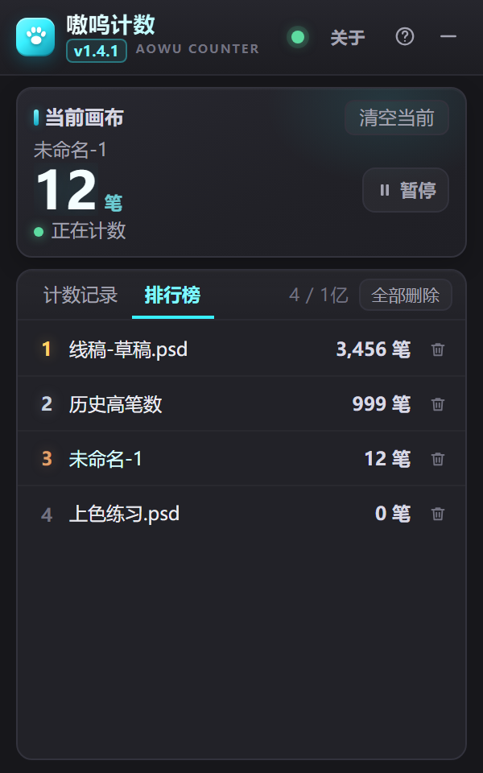
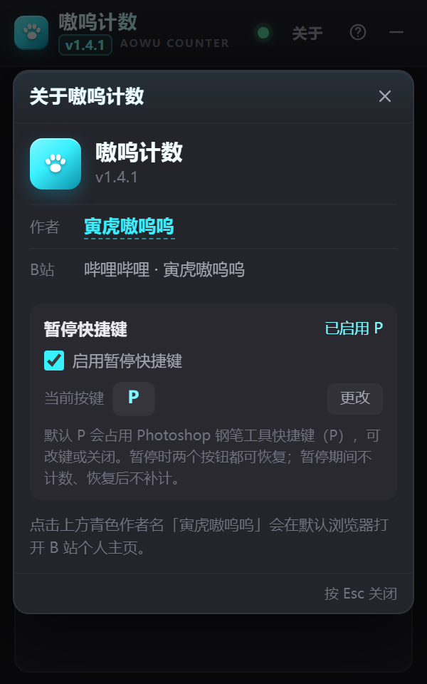

# 嗷呜计数 v1.4.1

> Photoshop 画笔计数 CEP 面板：自动统计每个画布画了多少笔，把「看不见的努力」变成看得见的数字。






## 简介

**嗷呜计数**是一个 Photoshop 面板插件（CEP 扩展，非 UXP）。保持面板打开后，它会自动监听 Photoshop 历史记录，
**只统计画笔 / 铅笔工具画出的真实笔迹**，按画布累计笔数：新建画布自动建记录、画一笔 +1、撤销不扣数、重做不重复加。
数据保存在本机用户目录，重装插件不会丢。

- 适用：**Windows 10/11** + Photoshop **CC 2019（20.0）及以上**；建议 Photoshop 2022（23.0）及以上；实测 Photoshop 2025 v26.0（CEP 12）。macOS 未提供打包安装器。
- 主题：纯深色、中文界面、无任何外部网络资源
- 面板尺寸：默认 300 × 480，可拉伸；点最小化后内容区约 230 × 28（只显示画布名 + 当前笔数 + 记录状态点；PS 自带面板标签栏仍占约 50px、无法由插件去掉，标题文字已隐藏，实际窗口约 232 × 81）

## 功能特性

- **自动计数**：画笔 / 铅笔每完成一笔历史状态 +1；点一下也算 1 笔。
- **准确不误伤**：撤销不扣数、重做不重复加；新建图层、滤镜、调整等菜单操作不计数。
- **按画布分开记**：每个画布一条记录；新建画布自动创建 0 笔记录；关掉 PS 重开同名 PSD 继续累计。
- **当前画布卡片**：大号笔数（千分位）、状态（正在计数 / 未记录 / 已达上限 / 没有打开的画布）、一键「清空当前」（二次确认）。
- **计数记录**：每行显示画布名 +「N 笔」，最多 1 亿个画布记录（与排行榜独立）；行内改名（Enter 保存 / Esc 取消 / 失焦保存）、行内删除（二次确认）、当前画布高亮 +「当前」标签。
- **笔数排行榜**：**独立历史榜**，按笔数从高到低排名（名次/画布名/N 笔），可单条删除，也可「全部删除」（二次确认）；**删除计数记录不会删排行榜，删除排行榜也不会删计数记录**。记录和排行榜各自只有用户主动删除才会消失，重启/重开面板不丢；各最多支持 1 亿条。
- **小面板 + 最小化**：默认尺寸更小；点「—」缩成约 230 × 28 的横条，显示当前画布名、当前笔数、绿/红记录状态点；最小化时 PS 面板标题文字隐藏，展开恢复；点击横条或展开按钮恢复原尺寸，**按住爪印图标可拖动工具条**。
- **记住最小化状态**：关闭 Photoshop 时如果面板正处在最小化状态，下次打开面板会自动以最小化横条出现；展开恢复上次的窗口尺寸。
- **最小化也继续计数**：折叠/最小化/被其他面板挡住时轮询不停，画布与计数照常累计。
- **暂停 / 继续**：当前画布卡片右侧中间有「暂停」按钮，最小化横条画布名后也有小暂停按钮；暂停时不记录任何笔迹，恢复后只从恢复那一刻继续计数（暂停期间画的不会补计）。
- **暂停快捷键**：默认 **P**（全局，焦点在画布上也能按）；可在「关于」里改成 A-Z / 0-9 单键，或取消快捷键。默认 P 会占用 Photoshop 钢笔工具快捷键，不习惯可改键或关闭。
- **关于 / 帮助**：顶栏「关于」打开作者与版本信息（作者 B站「寅虎嗷呜呜」可点击跳转）；「?」打开使用说明与注意事项。
- **连接状态只显示圆点**：绿=已连接/正常，红=未连接；连接失败不再弹提示，只红点静默重试。
- **名字忽略 .psd**：画布名比较时只去掉末尾一个 `.psd`——`未标题-1` 与 `未标题-1.psd` 视为同一记录；`测试.psd.psd` 保留一个 `.psd` 作为名字；旧数据里的同名记录加载时自动合并。
- **改名跟随**：PS 中 Save As / 重命名画布后，对应记录名自动跟随；若与已有记录重名则合并笔数。
- **边界保护**：最多 1 亿个画布记录（满了显示黄色提示条）；单画布封顶 1000 亿笔。
- **深色紧凑 UI**：纯 CSS 深色主题，滚动列表，适配 CEP 面板窄宽度；底部不再显示提示文案（说明已移入帮助）。
- **数据位置**：计数记录 `%APPDATA%\\AowuCounter\\aowu-counter-data.txt`；排行榜 `aowu-counter-leaderboard.txt`（删除墓碑 `aowu-counter-leaderboard-deleted.txt`）。重装/升级不清；写数据前备份到 `.txt.bak`，误删可手动恢复但不自动还原。

## 安装

1. 解压 `嗷呜计数_v1.4.1.zip` 到任意文件夹（**不要只解压出单个文件**）。
2. 双击 **`安装.bat`**，等待提示「安装完成」。
   - 也可以在解压目录执行：
     ```powershell
     powershell -NoProfile -ExecutionPolicy Bypass -File .\install.ps1
     ```
   - 安装脚本会把插件复制到 `%APPDATA%\Adobe\CEP\extensions\com.aowu.counter`，
     并为当前用户写入 CEP 未签名扩展所需的 `PlayerDebugMode=1`（HKCU `CSXS.8`～`CSXS.13`）。
3. **完全退出并重新启动 Photoshop**。
4. 打开菜单：**窗口 > 扩展（旧版） > 嗷呜计数**（旧版 PS 为「窗口 > 扩展功能」）。
5. 把面板停靠在顺手的位置，保持面板打开即可自动计数。

卸载：双击 `卸载.bat`（或运行 `uninstall.ps1`）。**默认保留计数数据**；如需连数据一起删除，运行
`powershell -NoProfile -ExecutionPolicy Bypass -File .\uninstall.ps1 -RemoveData`。

## 使用说明

1. **保持面板打开**：面板开着时才会统计；关闭面板期间的笔迹不会补算（重新打开面板从当下开始）。
2. **新建画布自动记录**：新建一个画布（如「未命名-1」）会自动出现在「计数记录」里，从 0 笔开始。
3. **画一笔 +1**：用画笔工具或铅笔工具在画布上落笔，计数自动 +1（点一下也算一笔）。
4. **清空当前**：点当前画布卡片右上角「清空当前」，按钮变为「确认清空?」后再点一次生效（3 秒内有效，否则自动还原）。
5. **改名**：点记录行右侧铅笔图标 → 输入新名字 → `Enter` 保存 / `Esc` 取消 / 点击别处自动保存；重名或空名会提示。
6. **删除记录**：点垃圾桶图标 → 行内变为「删除?」+「删除 / 取消」，再点「删除」生效（3 秒内有效）。
7. **1 亿个画布上限**：同时最多保存 1 亿个画布记录；达到上限后新画布不会创建记录，也不会计数，当前画布卡片下方会出现黄色提示条。删除旧记录后可重新计数。
8. **单画布上限 1000 亿笔**：到达上限后封顶不再增加（实际使用几乎不可能触及）。
9. **最小化**：点顶栏「—」，面板缩成约 230 × 28 的横条：显示画布名 + 当前笔数 + 绿/红状态点（绿=正在记录，红=未记录）；最小化时 PS 面板标题文字会隐藏。点横条或展开按钮恢复原尺寸；**按住左侧爪印图标可拖动工具条**。最小化期间仍然计数。关闭 PS 时若保持最小化，下次打开面板会继续是最小化状态。
10. **排行榜**：切到「排行榜」页，按笔数从高到低查看所有历史画布记录，可删除单个记录。
11. **帮助**：点顶栏「?」查看完整用法与注意事项（含「只统计画笔/铅笔真实笔迹 · 撤销不扣数」这句说明）。
12. **暂停 / 继续**：点当前画布卡片右侧的「暂停」，或最小化横条上的小暂停图标；暂停时计数冻结、状态显示「已暂停」，再点「继续」恢复。恢复后只统计恢复之后的笔迹。
13. **暂停快捷键**：默认按 `P` 暂停/继续；可在顶栏「关于」的「暂停快捷键」里改成 A-Z / 0-9 单键，或取消勾选关闭快捷键。默认 P 会占用 PS 钢笔工具快捷键，不习惯可改键。

### 数据保存位置

- Windows：`%APPDATA%\AowuCounter\aowu-counter-data.txt`
  （即 `C:\Users\<用户名>\AppData\Roaming\AowuCounter\aowu-counter-data.txt`）
- 每次计数变化立即写入，无需手动保存。
- **重装 / 升级插件不会清除数据**；卸载默认也保留数据（见上文 `-RemoveData`）。

## 常见问题

**Q：撤销一笔，计数会减吗？**
A：不会。撤销/重做只回到旧的历史状态，不会产生新的计数；撤销后继续画的新笔迹照常 +1。

**Q：重做（Ctrl+Shift+Z）会重复计数吗？**
A：不会。重做回到的是已计入的历史状态，不会再次 +1。

**Q：新建图层、滤镜、调整、菜单操作会计数吗？**
A：不会。只有历史状态名称匹配本机「画笔工具 / 铅笔工具」的操作才 +1。

**Q：面板关掉期间画的笔会补算吗？**
A：不会。插件只在面板打开时监听历史记录；重新打开面板后从当下状态开始建立基线，不补算关闭期间的笔迹。
切到后台、最小化成横条、被其他面板挡住时仍然会计数。

**Q：为什么又出现了一条新记录？**
A：记录以画布名为准。画布名不同（例如另存为不同文件名）就是新画布 → 新建记录；
同名画布会继续累计同一条记录（最多 10 条）。

**Q：可以手动改记录名吗？会影响 PS 画布名吗？**
A：可以（行内铅笔图标）。改名只改插件里的记录名，不会修改 Photoshop 画布名；之后若在 PS 里再次重命名画布，记录名会跟随新画布名。

**Q：红点/绿点是什么意思？**
A：顶栏圆点表示与 Photoshop 的连接：绿=已连接，红=未连接（正在静默重试）。
最小化横条上的圆点表示是否正在记录：绿=当前画布正在记录，红=未记录（没有画布 / 已达 1 亿上限 / 未连接）。

**Q：排行榜和计数记录有什么区别？**
A：计数记录按创建顺序管理（可改名/删除/清空）；排行榜按笔数从高到低展示同一批数据，适合看排名，也可以直接删除记录。数据永久保存在本机。

**Q：菜单里找不到「嗷呜计数」？**
A：① 确认已**完全退出并重启** Photoshop；② 菜单路径为 **窗口 > 扩展（旧版）> 嗷呜计数**；
③ 若仍不显示，重新运行 `安装.bat`（会写入 `PlayerDebugMode`）；④ 确认 Photoshop 为 CC 2019 (19.0) 及以上。

**Q：数据存在哪？换电脑 / 重装会丢吗？**
A：见上文「数据保存位置」。重装插件保留；卸载默认保留。手动备份该 txt 文件即可迁移。

**Q：关闭时是最小化，重开还是最小化吗？**
A：会。插件会记住最小化状态和上次展开尺寸，下次打开 Photoshop 面板时直接以最小化横条出现，点展开恢复上次尺寸。

**Q：最小化后还能拖动吗？怎么拖？**
A：可以。最小化横条左侧的蓝色爪印就是拖拽手柄，按住拖动即可移动工具条（PS 面板自带的标签栏拖动也可以）。

**Q：浏览器能预览界面吗？**
A：可以。直接用 Edge/Chrome 打开项目根目录的 `index.html?mock=1` 即为**预览模式**（示例数据、不会连接 Photoshop、不写磁盘）；
`?mock=1&view=leaderboard`、`?mock=1&view=help`、`?mock=1&view=mini` 可分别预览排行榜/帮助/最小化效果。

## 文件结构

```
aowu-counter/
├─ CSXS/manifest.xml          CEP 清单（v1.1.4，菜单「嗷呜计数」，默认 300×480 / 最小 180×24）
├─ index.html                 面板结构
├─ css/style.css              深色主题样式（青色 accent）
├─ js/csinterface.js          CEP 桥接（最小实现）
├─ js/bridge.js               面板 ↔ Photoshop 通信 + 浏览器 mock
├─ js/app.js                  面板 UI 逻辑（轮询 / 渲染 / 交互 / 最小化 / 排行榜 / 帮助）
├─ jsx/host.jsx               Photoshop 端（历史状态检测 / 模型 / 持久化）
├─ jsx/core.jsx               纯逻辑（模型 / 序列化）
├─ jsx/dom-detector.jsx       历史状态身份检测器（DOM 引用序列对比）
├─ jsx/window-drag.ps1        最小化横条拖动助手（wscript 隐藏启动，无命令窗口）
├─ jsx/hotkey.ps1             全局暂停快捷键助手（隐藏 PowerShell）
├─ icons/                     插件图标
├─ install.ps1 / uninstall.ps1 安装 / 卸载脚本
├─ 安装.bat / 卸载.bat         Windows 双击入口
├─ docs/preview-main.png      面板截图
├─ docs/preview-about.png     关于弹窗截图
├─ docs/preview-minimized.png 最小化横条截图
└─ README.md
```

> 注：`tests/`、`tools/` 为开发资料，不随安装包 zip 发布；`docs/` 在安装包中只包含 README 截图。

## 开发与自测

- 浏览器预览（mock）：用 Edge/Chrome 打开 `index.html?mock=1`；控制台可用
  `AowuCounterApp.mockAddStroke()` 模拟画一笔、`AowuCounterApp.getState()` 查看当前渲染状态。
- 纯逻辑单测：`tests/run-tests.ps1`（Node `node --test`，107 项）。
- 打包：`powershell -NoProfile -ExecutionPolicy Bypass -File .\tools\build.ps1`
  在工作区根目录生成 `嗷呜计数_v1.4.1.zip`。

## 版本历史

- **1.4.1（2026-11-09）**：修复计数记录笔数不同步到排行榜——记录继续增长超过用户删除排行榜时的笔数后，自动重新同步到排行榜；删除时墓碑记录当时笔数，避免误恢复/误重加。
- **1.4.0（2026-11-09）**：计数记录与排行榜**彻底独立**——删除计数记录不影响排行榜，删除排行榜不影响计数记录；排行榜单独持久化（含删除墓碑），历史高笔数不会因记录删除而消失；各上限 1 亿。
- **1.3.0（2026-11-09）**：画布记录/排行榜上限从 10 提升到 **1 亿**；新增「全部删除」；写数据前自动备份到 `.bak`，修复加载时可能误写空数据的问题。
- **1.2.1（2026-11-09）**：画布名匹配忽略末尾一个 `.psd`（`未标题-1` 与 `未标题-1.psd` 合并；`测试.psd.psd` 仍保留一个 `.psd` 作为名字）；旧数据加载时自动合并同名记录。
- **1.2.0（2026-11-09）**：新增随时暂停/继续（主面板右侧 + 最小化横条按钮）；暂停期间不记录、恢复后不补计暂停期间的笔画；新增全局暂停快捷键（默认 P，可在关于里改单键或禁用）。
- **1.1.4（2026-11-08）**：大数字显示优化——当前画布、记录、排行榜、最小化横条在 1000 亿时完整显示。
- **1.1.3（2026-11-08）**：顶栏「关于」入口与关于弹窗；作者 B站「寅虎嗷呜呜」青色可点击链接。
- **1.1.2（2026-11-08）**：最小化再缩小到约 230×28；记住最小化状态；隐藏启动拖拽助手窗口。
- **1.1.1（2026-11-08）**：移除底部提示文案；最小化横条更小、隐藏 PS 面板标题、爪印可拖动。
- **1.1.0（2026-11-08）**：新增小面板 + 最小化横条、笔数排行榜、帮助弹窗、只显示红绿连接点。
- **1.0.0（2026-11-07）**：首版。画笔/铅笔自动计数、按画布记录、撤销/重做/菜单操作准确不误伤、
  清空 / 改名 / 删除、10 画布上限与 100 亿封顶、深色 CEP 面板、一键安装/卸载、浏览器 mock 预览。

## 版本号规则

- 修复 / 小迭代：`1.0.1`、`1.0.2`、`1.0.3`……
- 新增功能：`1.1.0`、`1.1.1`、`1.1.2`……（次版本号 +1）
- 大改版：`2.0.0`（仅在用户明确要求时使用）
- 面板顶栏与清单里的版本号需同步修改；`tools/build.ps1 -Version x.y.z` 可打包对应版本。
